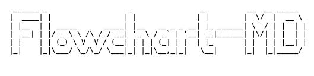
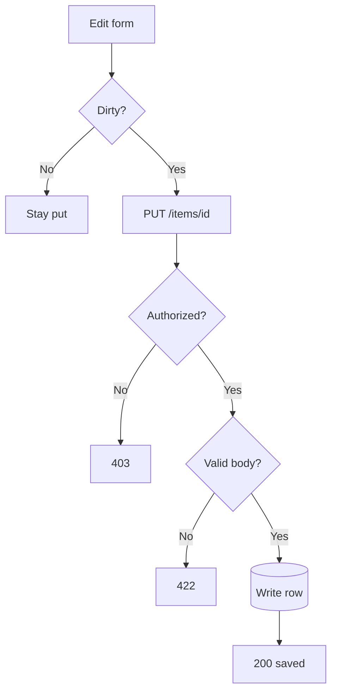
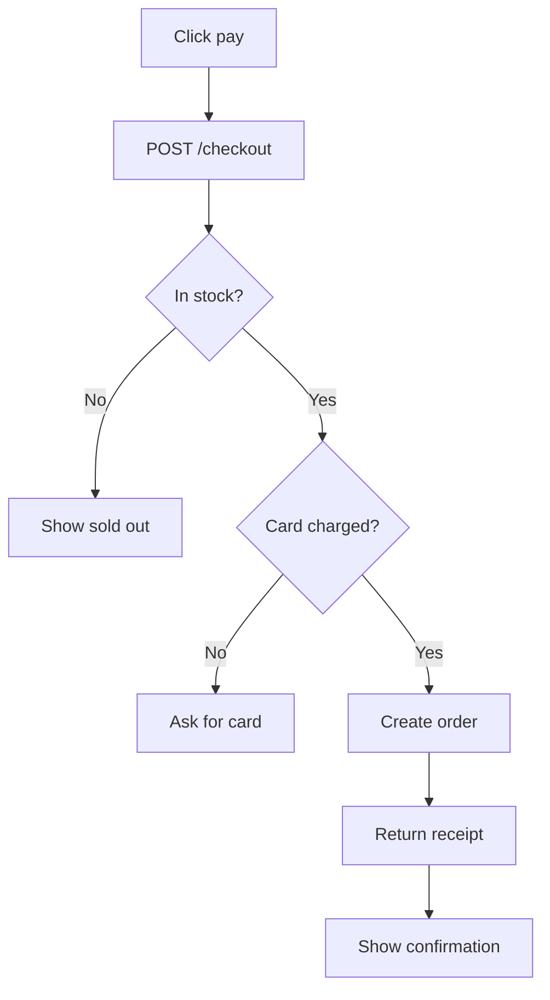
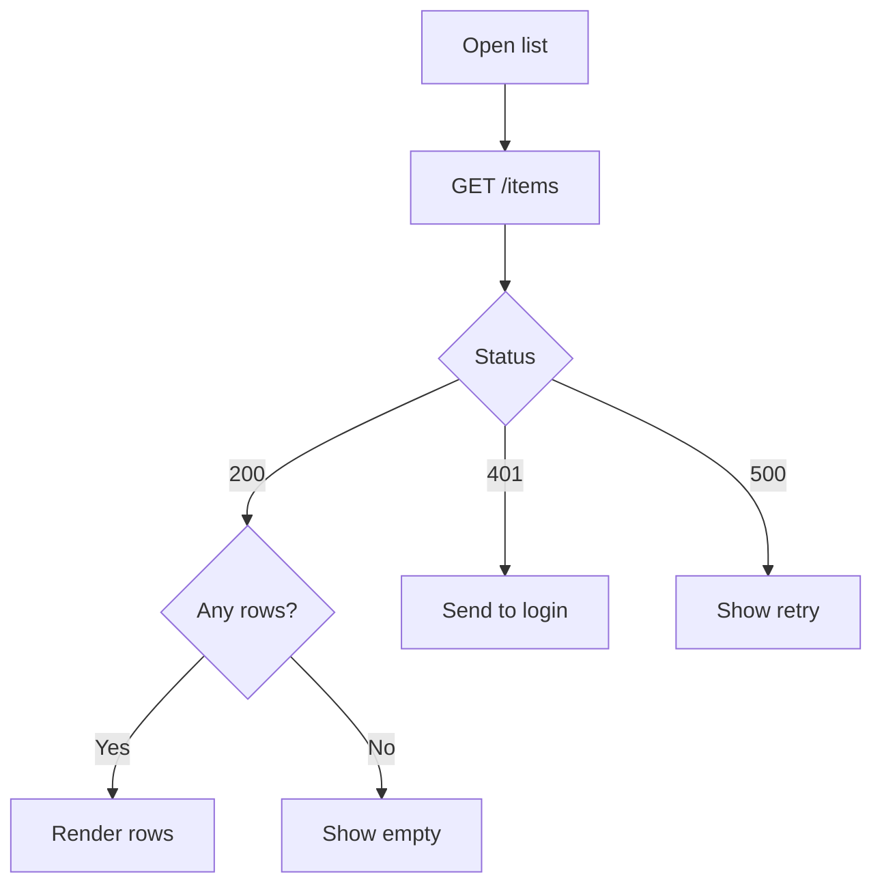

<p align="center">
  <picture>
    <source srcset="./github/logo-dark.png" media="(prefers-color-scheme: dark)" />
    <source srcset="./github/logo-light.png" media="(prefers-color-scheme: light)" />
    
  </picture>
</p>

<p align="center"><b>Visualize logic with agents.</b><br>Ask how something works. The flowchart shows up in the chat.</p>

<p align="center">
  
</p>

```text
                     ┌────────────────┐                         
                     │                │                         
                     │     Submit     │                         
                     │                │                         
                     └────────┬───────┘                         
                              │                                 
                              │                                 
                              │                                 
                              │                                 
                              ▼                                 
                     ◇────────────────◇                         
                     │                │                         
       ┌─────────────┤   Fields ok?   ├──────────┐              
       │             │                │          │              
       │             ◇────────────────◇          │              
      No                                        Yes             
       │                                         │              
       │                                         │              
       │                                         │              
       ▼                                         ▼              
┌─────────────┐                          ┌──────────────┐       
│             │                          │              │       
│ Show errors │                          │ POST /login  │       
│             │                          │              │       
└─────────────┘                          └───────┬──────┘       
                                                 │              
                                                 │              
                                                 │              
                                                 │              
                                                 ▼              
                                         ◇──────────────◇       
                                         │              │       
                                      ┌──┤ Password ok? ├───┐   
                                      │  │              │   │   
                                      │  ◇──────────────◇   │   
                                     No                    Yes  
                                      │                     │   
                                      │                     │   
                                      │                     │   
                                      ▼                     ▼   
                              ┌────────────────┐        ┌──────┐
                              │                │        │      │
                              │      401       │        │ Home │
                              │                │        │      │
                              └────────────────┘        └──────┘
```

<p align="center"><sub>A sign-in. The form checks the fields. The server checks the password.</sub></p>

## Why

Seeing the system makes it easier to understand, and easier to change. You and the agent look at the same picture: where a request starts, what it checks, and where it ends. Adjust the design, ask again, and the next picture is the next version.

## Install

### Claude Code

```sh
claude mcp add --scope user flowchart-md -- npx -y github:ralf-al/flowchart-md
```

Then ask Claude to draw how a sign-in works. The flowchart shows up in the chat.

### Cursor

Add this to `.cursor/mcp.json`:

```json
{
  "mcpServers": {
    "flowchart-md": {
      "command": "npx",
      "args": ["-y", "github:ralf-al/flowchart-md"]
    }
  }
}
```

Reload MCP, then ask the agent to draw the logic.

### Other agents

Any MCP client can run the same server:

```sh
npx -y github:ralf-al/flowchart-md
```

## Examples

Written in  [Mermaid](https://mermaid.js.org/), the syntax agents already know.

### Save

The client only sends a change. The server then checks who is calling, then whether the body is valid, then writes.



```text
                 ┌───────────┐                                                        
                 │           │                                                        
                 │ Edit form │                                                        
                 │           │                                                        
                 └─────┬─────┘                                                        
                       │                                                              
                       │                                                              
                       │                                                              
                       │                                                              
                       ▼                                                              
                 ◇───────────◇                                                        
                 │           │                                                        
      ┌──────────┤   Dirty?  ├────────────────┐                                       
      │          │           │                │                                       
      │          ◇───────────◇                │                                       
     No                                      Yes                                      
      │                                       │                                       
      │                                       │                                       
      │                                       │                                       
      ▼                                       ▼                                       
┌──────────┐                        ┌───────────────────┐                             
│          │                        │                   │                             
│ Stay put │                        │   PUT /items/id   │                             
│          │                        │                   │                             
└──────────┘                        └─────────┬─────────┘                             
                                              │                                       
                                              │                                       
                                              │                                       
                                              │                                       
                                              ▼                                       
                                    ◇───────────────────◇                             
                                    │                   │                             
                       ┌────────────┤    Authorized?    ├─────────┐                   
                       │            │                   │         │                   
                       │            ◇───────────────────◇         │                   
                      No                                         Yes                  
                       │                                          │                   
                       │                                          │                   
                       │                                          │                   
                       ▼                                          ▼                   
                 ┌───────────┐                             ◇─────────────◇            
                 │           │                             │             │            
                 │    403    │                          ┌──┤ Valid body? ├─────┐      
                 │           │                          │  │             │     │      
                 └───────────┘                          │  ◇─────────────◇     │      
                                                       No                     Yes     
                                                        │                      │      
                                                        │                      │      
                                                        │                      │      
                                                        │                      │      
                                                        ▼                      ▼      
                                              ┌───────────────────┐      ╭───────────╮
                                              │                   │      │           │
                                              │        422        │      │ Write row │
                                              │                   │      │           │
                                              │                   │      │           │
                                              └───────────────────┘      ╰─────┬─────╯
                                                                               │      
                                                                               │      
                                                                               │      
                                                                               │      
                                                                               ▼      
                                                                         ┌───────────┐
                                                                         │           │
                                                                         │ 200 saved │
                                                                         │           │
                                                                         └───────────┘
```

### Pay

The click leaves the client. Stock and the card are both server decisions, and only both passing creates the order.



```text
                       ┌────────────────────┐                                                
                       │                    │                                                
                       │     Click pay      │                                                
                       │                    │                                                
                       └──────────┬─────────┘                                                
                                  │                                                          
                                  │                                                          
                                  │                                                          
                                  │                                                          
                                  ▼                                                          
                       ┌────────────────────┐                                                
                       │                    │                                                
                       │   POST /checkout   │                                                
                       │                    │                                                
                       └──────────┬─────────┘                                                
                                  │                                                          
                                  │                                                          
                                  │                                                          
                                  │                                                          
                                  ▼                                                          
                       ◇────────────────────◇                                                
                       │                    │                                                
        ┌──────────────┤     In stock?      ├───────────────────┐                            
        │              │                    │                   │                            
        │              ◇────────────────────◇                   │                            
       No                                                      Yes                           
        │                                                       │                            
        │                                                       │                            
        │                                                       │                            
        ▼                                                       ▼                            
┌───────────────┐                                       ◇───────────────◇                    
│               │                                       │               │                    
│ Show sold out │                                ┌──────┤ Card charged? ├─────────┐          
│               │                                │      │               │         │          
└───────────────┘                                │      ◇───────────────◇         │          
                                                No                               Yes         
                                                 │                                │          
                                                 │                                │          
                                                 │                                │          
                                                 ▼                                ▼          
                                  ┌─────────────────────────────┐       ┌───────────────────┐
                                  │                             │       │                   │
                                  │         Ask for card        │       │    Create order   │
                                  │                             │       │                   │
                                  └─────────────────────────────┘       └─────────┬─────────┘
                                                                                  │          
                                                                                  │          
                                                                                  │          
                                                                                  │          
                                                                                  ▼          
                                                                        ┌───────────────────┐
                                                                        │                   │
                                                                        │   Return receipt  │
                                                                        │                   │
                                                                        └─────────┬─────────┘
                                                                                  │          
                                                                                  │          
                                                                                  │          
                                                                                  │          
                                                                                  ▼          
                                                                        ┌───────────────────┐
                                                                        │                   │
                                                                        │ Show confirmation │
                                                                        │                   │
                                                                        └───────────────────┘
```

### Load a list

One request, three server answers, and a second question only on the success path.



```text
                    ┌───────────────┐                   
                    │               │                   
                    │   Open list   │                   
                    │               │                   
                    └───────┬───────┘                   
                            │                           
                            │                           
                            │                           
                            │                           
                            ▼                           
                    ┌───────────────┐                   
                    │               │                   
                    │   GET /items  │                   
                    │               │                   
                    └───────┬───────┘                   
                            │                           
                            │                           
                            │                           
                            │                           
                            ▼                           
                    ◇───────────────◇                   
                    │               │                   
       ┌────────────┤     Status    ├────────────┐      
       │            │               │            │      
       │            ◇───────┬───────◇            │      
      200                  401                  500     
       │                    │                    │      
       │                    │                    │      
       │                    │                    │      
       ▼                    ▼                    ▼      
◇─────────────◇     ┌───────────────┐     ┌────────────┐
│             │     │               │     │            │
│  Any rows?  ├──┐  │ Send to login │     │ Show retry │
│             │  │  │               │     │            │
◇──────┬──────◇  │  └───────────────┘     └────────────┘
      Yes        │                                      
       │         │                                      
       │         └─────────No                           
       │                    │                           
       ▼                    ▼                           
┌─────────────┐     ┌───────────────┐                   
│             │     │               │                   
│ Render rows │     │   Show empty  │                   
│             │     │               │                   
└─────────────┘     └───────────────┘
```

## Usage

`render-flowchart` takes one argument, `mermaid`, and returns `markdown`.

```text
graph TD
  A[Form submit] --> B{Fields valid?}
  B -->|No| C[Show errors]
  B -->|Yes| D[POST /login]
```

Shapes the parser draws:

| Write            | Meaning          |
| ---------------- | ---------------- |
| `A[Step]`        | A step           |
| `B{Question?}`   | A decision       |
| `C(Note)`        | A rounded step   |
| `D([Start])`     | A start or end   |
| `E[(Database)]`  | A cylinder       |
| `A --> B`        | An arrow         |
| `B -->\|Yes\| C` | A labeled branch |

`graph` and `flowchart` both work, with direction `TD`, `TB`, `LR`, `BT`, or `RL`. Subgraphs, dotted edges (`-.->`), and thick edges (`==>`) work too. Keep labels to a few words so the boxes stay readable.

The returned markdown is already a fenced code block. Paste it into the reply as it is.

## Limits

The tool accepts `graph` and `flowchart` only. Anything else is an error, including sequence, class, state, ER, and XY charts.

The picture is plain text. It needs a monospace font, which a markdown code block provides. A graph with many crossing loops can get crowded. A labeled arrow that leaves the side of a node can start a short gap away from the box. That comes from the grid layout we inherited. Short labels and a top-to-bottom direction avoid most of it.

## Credit

The renderer is the flowchart path from [beautiful-mermaid](https://github.com/lukilabs/beautiful-mermaid) by Craft Docs, used under the MIT license in [src/render/LICENSE](src/render/LICENSE).

beautiful-mermaid's ASCII engine is a TypeScript port of [mermaid-ascii](https://github.com/AlexanderGrooff/mermaid-ascii) by Alexander Grooff. Craft Docs ported it from Go and extended it with sequence, class, and ER diagrams, Unicode box-drawing, and configurable spacing. Thank you, Alexander, for the layout. Thank you, Craft Docs, for the port.

We kept flowcharts. A flowchart is the diagram that helps someone check a decision, so that is the surface we maintain. The sequence, class, ER, state, and XY renderers from upstream stayed behind.

Two flowchart bugs from that port are fixed here.

A node mentioned before it was given a shape used to keep its id as the label. `A --> B` followed later by `B[Check token]` now draws **Check token**.

The picture is plain text. The upstream renderer would color the boxes for a terminal, and those color codes would show up inside the markdown. Chat gets the box drawing on its own.

## License

flowchart-md is [ISC](https://opensource.org/license/isc).

The renderer in `src/render` is MIT. The license text is in [src/render/LICENSE](src/render/LICENSE).
