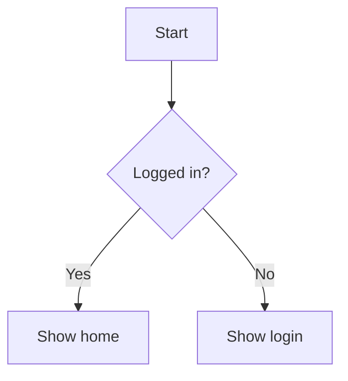
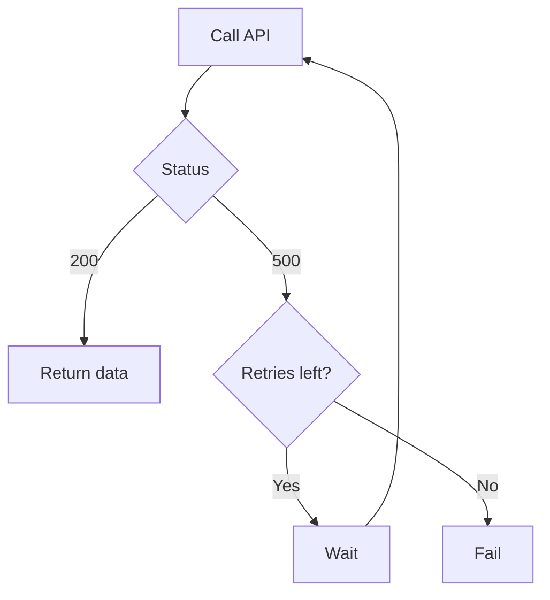
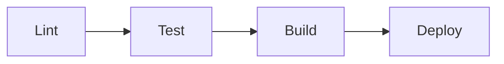

# flowchart-md

**Print a flowchart as markdown.**

Agents already write markdown well. This puts the picture in that markdown, so a branch shows up in chat.


[Quick start](#quick-start) · [Samples](#samples) · [Why](#why) · [Credit](#credit) · [Usage](#usage) · [How it works](#how-it-works) · [Limits](#limits)

```text
 ______ _                   _                _          __  __ _____
|  ____| |                 | |              | |        |  \/  |  __ \
| |__  | | _____      _____| |__   __ _ _ __| |_ ______| \  / | |  | |
|  __| | |/ _ \ \ /\ / / __| '_ \ / _` | '__| __|______| |\/| | |  | |
| |    | | (_) \ V  V / (__| | | | (_| | |  | |_       | |  | | |__| |
|_|    |_|\___/ \_/\_/ \___|_| |_|\__,_|_|   \__|      |_|  |_|_____/
```

---

Ask an agent to explain a process and it will often write the condition in a sentence. The sentence can be right and still be hard to audit. flowchart-md gives the agent a flowchart in the markdown it already writes well: a step is a box, a question is a diamond, and each answer is a labeled arrow. The picture comes back as a markdown code block, so it shows up in chat.

## Quick start

Add this to the MCP client. In Cursor, that is `.cursor/mcp.json`:

```json
{
  "mcpServers": {
    "flowchart-md": {
      "command": "npx",
      "args": ["-y", "github:ralf-al/flowchart-md"]
    }
  }
}
```

Reload the server, then ask for a flowchart of the logic you want to check. The tool is `render-flowchart`. It returns a markdown code block. The agent pastes that block into the reply unchanged.

Node 24 or later. The server speaks MCP over stdio.

To work on this repo:

```sh
npm install
npm run build
```

## Samples

Each block below is the tool's output for that source.

### A decision



```text
┌────────────┐
│            │
│   Start    │
│            │
└──────┬─────┘
       │
       │
       │
       │
       ▼
◇────────────◇
│            │
│ Logged in? ├────────────┐
│            │            │
◇──────┬─────◇           No
       │                  │
      Yes                 │
       │                  │
       │                  │
       ▼                  ▼
┌────────────┐     ┌────────────┐
│            │     │            │
│ Show home  │     │ Show login │
│            │     │            │
└────────────┘     └────────────┘
```

### A retry



```text
┌─────────────┐
│             │
│   Call API  │◄─┐
│             │  │
└──────┬──────┘  │
       │         │
       │         │
       │         │
       │         │
       ▼         │
◇─────────────◇  │
│             │  │
│    Status   ├──┼──────────┐
│             │  │          │
◇──────┬──────◇  │         500
       │         │          │
      200        │          │
       │         │          │
       │         │          │
       ▼         │          ▼
┌─────────────┐  │  ◇───────────────◇
│             │  │  │               │
│ Return data │  ├──┤ Retries left? │
│             │  │  │               │
└─────────────┘  │  ◇───────┬───────◇
                 │          │
                 │         No
      Yes────────┤          │
       │         │          │
       ▼         │          ▼
┌─────────────┐  │  ┌───────────────┐
│             │  │  │               │
│     Wait    ├──┘  │      Fail     │
│             │     │               │
└─────────────┘     └───────────────┘
```

The `Yes` arrow from `Retries left?` runs back to `Call API`. The `No` arrow ends at `Fail`. That loop is the thing a paragraph tends to blur.

### A pipeline



```text
┌──────┐     ┌──────┐     ┌───────┐     ┌────────┐
│      │     │      │     │       │     │        │
│ Lint ├────►│ Test ├────►│ Build ├────►│ Deploy │
│      │     │      │     │       │     │        │
└──────┘     └──────┘     └───────┘     └────────┘
```

`graph TD` fits a process with questions. `graph LR` fits a straight pipeline.

## Why

Conditional logic is where an explanation goes wrong quietly. "If the call fails and retries are left, wait and try again, otherwise fail" is easy to nod at and easy to swap. Drawn out, the `200` path, the retry path, and the give-up path are three different arrows. You can see which question they leave and which box they enter.

That is the use. An agent reaches for this when it is walking a user through a decision: a login check, a payment branch, an approval, a retry, a rollback. The diagram is there so the user can verify the condition.

## Credit

The renderer is the flowchart path from [beautiful-mermaid](https://github.com/lukilabs/beautiful-mermaid) by Craft Docs, used under the MIT license in [src/render/LICENSE](src/render/LICENSE).

beautiful-mermaid's ASCII engine is a TypeScript port of [mermaid-ascii](https://github.com/AlexanderGrooff/mermaid-ascii) by Alexander Grooff. Craft Docs ported it from Go and extended it with sequence, class, and ER diagrams, Unicode box-drawing, and configurable spacing. Thank you, Alexander, for the layout. Thank you, Craft Docs, for the port.

We kept flowcharts. A flowchart is the diagram that helps someone check a decision, so that is the surface we maintain. The sequence, class, ER, state, and XY renderers from upstream stayed behind.

Two flowchart bugs from that port are fixed here.

A node mentioned before it was given a shape used to keep its id as the label. `A --> B` followed later by `B[Check token]` now draws **Check token**.

The picture is plain text. The upstream renderer would color the boxes for a terminal, and those color codes would show up inside the markdown. Chat gets the box drawing on its own.

## Usage

`render-flowchart` takes one argument, `mermaid`, and returns `markdown`.

```text
graph TD
  A[Start] --> B{Logged in?}
  B -->|Yes| C[Show home]
  B -->|No| D[Show login]
```

Shapes the parser draws:

| Write           | Meaning        |
| --------------- | -------------- |
| `A[Step]`       | A step         |
| `B{Question?}`  | A decision     |
| `C(Note)`       | A rounded step |
| `D([Start])`    | A start or end |
| `E[(Database)]` | A cylinder     |
| `A --> B`       | An arrow       |
| `B -->\|Yes\| C` | A labeled branch |

`graph` and `flowchart` both work, with direction `TD`, `TB`, `LR`, `BT`, or `RL`. Subgraphs, dotted edges (`-.->`), and thick edges (`==>`) work too. Keep labels to a few words so the boxes stay readable.

The returned markdown is already a fenced code block. Paste it into the reply as it is.

## How it works

The server is a stdio MCP process. `render-flowchart` checks that the source is a flowchart, parses it into nodes and edges, lays the graph out on a character grid, and draws it with Unicode box-drawing characters. The string that comes back is the diagram.

## Limits

The tool accepts `graph` and `flowchart` only. Anything else is an error, including sequence, class, state, ER, and XY charts.

The picture is plain text. It needs a monospace font, which a markdown code block provides. A graph with many crossing loops can get crowded. A labeled arrow that leaves the side of a node can start a short gap away from the box. That comes from the grid layout we inherited. Short labels and a top-to-bottom direction avoid most of it.
