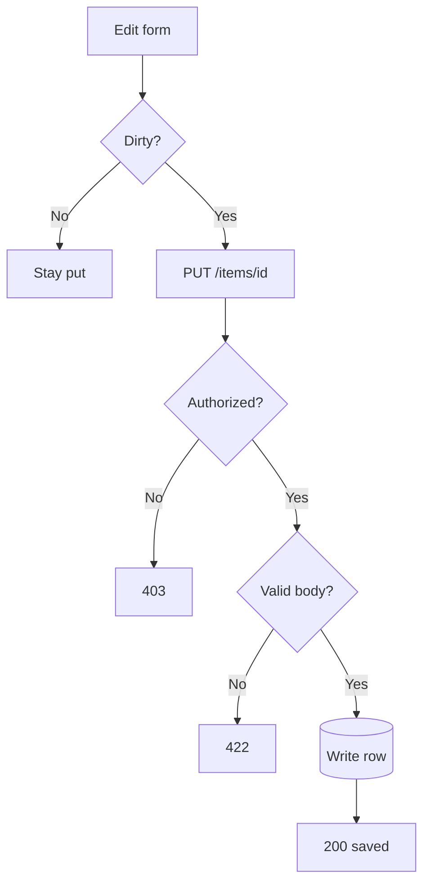
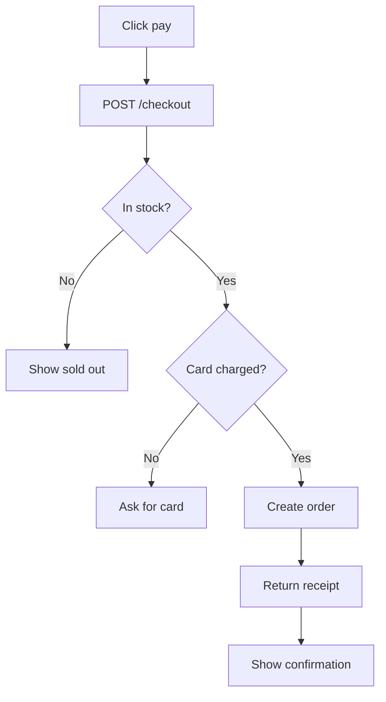
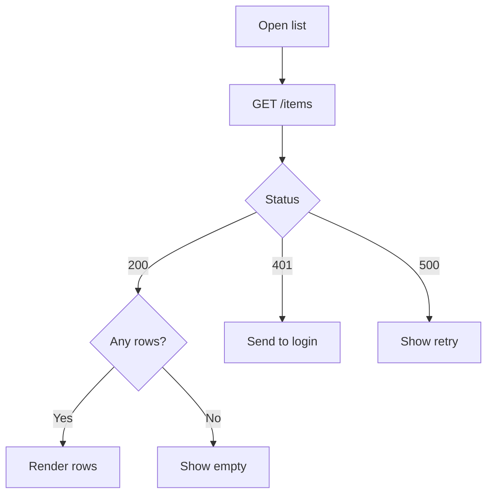

<p align="center">
  <picture>
    <source srcset="./github/logo-dark.png" media="(prefers-color-scheme: dark)" />
    <source srcset="./github/logo-light.png" media="(prefers-color-scheme: light)" />
    
  </picture>
</p>

<p align="center"><b>Print a flowchart as markdown.</b><br>An agent shows the branch in chat, in the markdown it already writes.</p>

<p align="center">
  
  
  
</p>

```text
┌─────────────────┐
│                 │
│   Form submit   │
│                 │
└────────┬────────┘
         │
         │
         │
         │
         ▼
◇─────────────────◇
│                 │
│  Fields valid?  ├────────────┐
│                 │            │
◇────────┬────────◇           Yes
         │                     │
        No                     │
         │                     │
         │                     │
         ▼                     ▼
┌─────────────────┐     ┌─────────────┐
│                 │     │             │
│   Show errors   │     │ POST /login │
│                 │     │             │
└─────────────────┘     └──────┬──────┘
                               │
                               │
                               │
                               │
                               │
◇─────────────────◇            │
│                 │            │
│ Credentials ok? ├◄───────────┤
│                 │            │
◇────────┬────────◇           Yes
         │                     │
        No                     │
         │                     │
         │                     │
         ▼                     ▼
┌─────────────────┐     ┌─────────────┐
│                 │     │             │
│       401       │     │ Set session │
│                 │     │             │
└─────────────────┘     └──────┬──────┘
                               │
                               │
                               │
                               │
                               │
┌─────────────────┐            │
│                 │            │
│  Redirect home  │◄───────────┘
│                 │
└─────────────────┘
```

<p align="center"><sub>A sign-in, as it shows up in chat. The form checks the fields. The server checks the credentials.</sub></p>

## Install

Add this to the MCP client. In Cursor, that is `.cursor/mcp.json`.

```json
{
  "mcpServers": {
    "flowchart-md": {
      "command": "npx",
      "args": ["-y", "github:ralf-al/flowchart-md"]
    }
  }
}
```

Reload the server, then ask for a flowchart of the logic you want to check. The tool is `render-flowchart`. It returns a markdown code block. The agent pastes that block into the reply unchanged.

Node 24 or later.

## Examples

### Save

The client only sends a change. The server then checks who is calling, then whether the body is valid, then writes.



```text
┌─────────────┐
│             │
│  Edit form  │
│             │
└──────┬──────┘
       │
       │
       │
       │
       ▼
◇─────────────◇
│             │
│    Dirty?   ├─────────────┐
│             │             │
◇──────┬──────◇            Yes
       │                    │
      No                    │
       │                    │
       │                    │
       ▼                    ▼
┌─────────────┐     ┌───────────────┐
│             │     │               │
│   Stay put  │     │ PUT /items/id │
│             │     │               │
└─────────────┘     └───────┬───────┘
                            │
                            │
                            │
                            │
                            │
◇─────────────◇             │
│             │             │
│ Authorized? ├◄────────────┤
│             │             │
◇──────┬──────◇            Yes
       │                    │
      No                    │
       │                    │
       │                    │
       ▼                    ▼
┌─────────────┐     ◇───────────────◇
│             │     │               │
│     403     │  ┌──┤  Valid body?  │
│             │  │  │               │
└─────────────┘  │  ◇───────┬───────◇
                 │          │
                 │         Yes
       ┌─────────┘          │
      No                    │
       │                    │
       ▼                    ▼
┌─────────────┐     ╭───────────────╮
│             │     │               │
│     422     │     │   Write row   │
│             │     │               │
│             │     │               │
└─────────────┘     ╰───────┬───────╯
                            │
                            │
                            │
                            │
                            │
┌─────────────┐             │
│             │             │
│  200 saved  │◄────────────┘
│             │
└─────────────┘
```

### Pay

The click leaves the client. Stock and the card are both server decisions, and only both passing creates the order.



```text
┌───────────────────┐
│                   │
│     Click pay     │
│                   │
└─────────┬─────────┘
          │
          │
          │
          │
          ▼
┌───────────────────┐
│                   │
│   POST /checkout  │
│                   │
└─────────┬─────────┘
          │
          │
          │
          │
          ▼
◇───────────────────◇
│                   │
│     In stock?     ├─────────────┐
│                   │             │
◇─────────┬─────────◇            Yes
          │                       │
         No                       │
          │                       │
          │                       │
          ▼                       ▼
┌───────────────────┐     ◇───────────────◇
│                   │     │               │
│   Show sold out   │  ┌──┤ Card charged? │
│                   │  │  │               │
└───────────────────┘  │  ◇───────┬───────◇
                       │          │
                       │         Yes
         No────────────┘          │
          │                       │
          ▼                       ▼
┌───────────────────┐     ┌───────────────┐
│                   │     │               │
│    Ask for card   │     │  Create order │
│                   │     │               │
└───────────────────┘     └───────┬───────┘
                                  │
                                  │
                                  │
                                  │
                                  │
┌───────────────────┐             │
│                   │             │
│   Return receipt  │◄────────────┘
│                   │
└─────────┬─────────┘
          │
          │
          │
          │
          ▼
┌───────────────────┐
│                   │
│ Show confirmation │
│                   │
└───────────────────┘
```

### Load a list

One request, three server answers, and a second question only on the success path.



```text
┌─────────────┐
│             │
│  Open list  │
│             │
└──────┬──────┘
       │
       │
       │
       │
       ▼
┌─────────────┐
│             │
│  GET /items │
│             │
└──────┬──────┘
       │
       │
       │
       │
       ▼
◇─────────────◇
│             │
│    Status   ├─────┬───────┐
│             │     │       │
◇──────┬──────◇     └──────401───────────────────┐
       │                    │                    │
      200                   │                   500
       │                    │                    │
       │                    │                    │
       ▼                    ▼                    ▼
◇─────────────◇     ┌───────────────┐     ┌────────────┐
│             │     │               │     │            │
│  Any rows?  ├──┐  │ Send to login │     │ Show retry │
│             │  │  │               │     │            │
◇──────┬──────◇  │  └───────────────┘     └────────────┘
       │         │
      Yes        │
       │         └─────────No
       │                    │
       ▼                    ▼
┌─────────────┐     ┌───────────────┐
│             │     │               │
│ Render rows │     │   Show empty  │
│             │     │               │
└─────────────┘     └───────────────┘
```

## Why

Conditional logic is where an explanation goes wrong quietly. "If the call fails and retries are left, wait and try again, otherwise fail" is easy to nod at and easy to swap. Drawn out, each answer is its own arrow. You can see which question it leaves and which box it enters.

That is the use. An agent reaches for this when it is walking a user through a request: a form check, an auth check, a stock check, a status code. The diagram is there so the user can verify the condition.

## Usage

`render-flowchart` takes one argument, `mermaid`, and returns `markdown`.

```text
graph TD
  A[Form submit] --> B{Fields valid?}
  B -->|No| C[Show errors]
  B -->|Yes| D[POST /login]
```

Shapes the parser draws:

| Write            | Meaning          |
| ---------------- | ---------------- |
| `A[Step]`        | A step           |
| `B{Question?}`   | A decision       |
| `C(Note)`        | A rounded step   |
| `D([Start])`     | A start or end   |
| `E[(Database)]`  | A cylinder       |
| `A --> B`        | An arrow         |
| `B -->\|Yes\| C` | A labeled branch |

`graph` and `flowchart` both work, with direction `TD`, `TB`, `LR`, `BT`, or `RL`. Subgraphs, dotted edges (`-.->`), and thick edges (`==>`) work too. Keep labels to a few words so the boxes stay readable.

The returned markdown is already a fenced code block. Paste it into the reply as it is.

## Limits

The tool accepts `graph` and `flowchart` only. Anything else is an error, including sequence, class, state, ER, and XY charts.

The picture is plain text. It needs a monospace font, which a markdown code block provides. A graph with many crossing loops can get crowded. A labeled arrow that leaves the side of a node can start a short gap away from the box. That comes from the grid layout we inherited. Short labels and a top-to-bottom direction avoid most of it.

## Credit

The renderer is the flowchart path from [beautiful-mermaid](https://github.com/lukilabs/beautiful-mermaid) by Craft Docs, used under the MIT license in [src/render/LICENSE](src/render/LICENSE).

beautiful-mermaid's ASCII engine is a TypeScript port of [mermaid-ascii](https://github.com/AlexanderGrooff/mermaid-ascii) by Alexander Grooff. Craft Docs ported it from Go and extended it with sequence, class, and ER diagrams, Unicode box-drawing, and configurable spacing. Thank you, Alexander, for the layout. Thank you, Craft Docs, for the port.

We kept flowcharts. A flowchart is the diagram that helps someone check a decision, so that is the surface we maintain. The sequence, class, ER, state, and XY renderers from upstream stayed behind.

Two flowchart bugs from that port are fixed here.

A node mentioned before it was given a shape used to keep its id as the label. `A --> B` followed later by `B[Check token]` now draws **Check token**.

The picture is plain text. The upstream renderer would color the boxes for a terminal, and those color codes would show up inside the markdown. Chat gets the box drawing on its own.

## License

flowchart-md is [ISC](https://opensource.org/license/isc).

The renderer in `src/render` is MIT. The license text is in [src/render/LICENSE](src/render/LICENSE).
